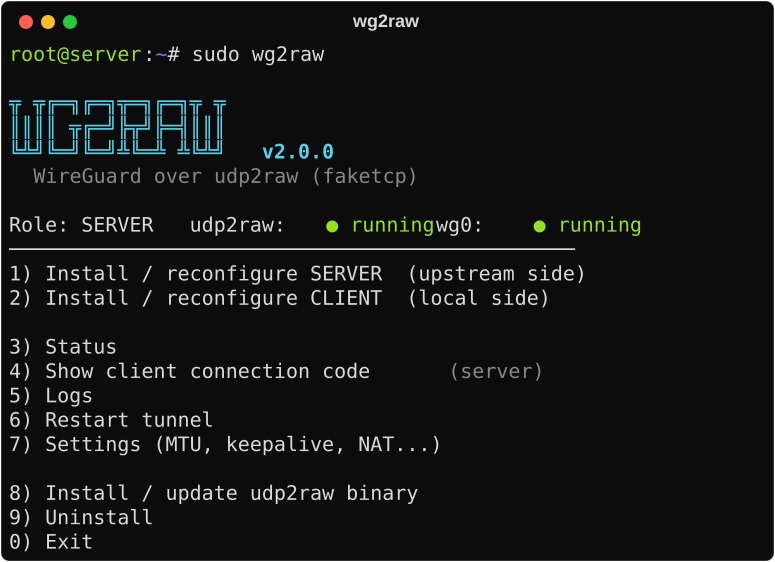
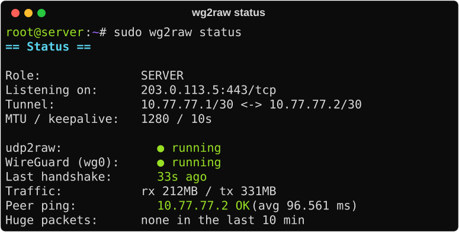
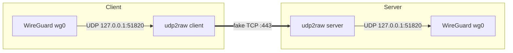

# wg2raw

A menu-driven Bash tool that sets up and manages a **WireGuard tunnel over [udp2raw](https://github.com/wangyu-/udp2raw) (faketcp)** between two Linux servers.

- **Server**: the public, upstream machine. udp2raw listens on a TCP port.
- **Client**: the machine behind the restrictive network. udp2raw connects out, and WireGuard talks to `127.0.0.1`.

WireGuard's UDP packets are wrapped in fake TCP, which helps on networks that block or throttle plain UDP.

<p align="center">
  
  
</p>

The status line (`Role / udp2raw / wg0`) appears after the first install. Before that, the menu shows `Not installed yet`.

## How it works



## Quick start

You need Debian or Ubuntu with systemd, and root access.

**1. On the server (upstream side)**

```bash
curl -fLO https://raw.githubusercontent.com/javadkhammari/wg2raw/main/wg2raw.sh
sudo bash wg2raw.sh
```

Choose `1`, then press Enter to accept the defaults. At the end the script prints a one-line **connection code** that starts with `wg2raw:`.

**2. On the client (local side)**

```bash
sudo bash wg2raw.sh
```

Choose `2` and paste the code. That's all: keys, password, ports and tunnel IPs all come from the code.

After the first install, open the menu any time with:

```bash
sudo wg2raw
```

## Features

- **One code to connect.** The server generates the client's keys too, so you never copy public keys back and forth.
- **Installs udp2raw for you.** It downloads the official release for your CPU, or installs from a local file if GitHub is not reachable.
- **Status screen.** Shows services, last handshake, traffic, a ping to the other side, and udp2raw "huge packet" warnings.
- **Settings menu.** Change MTU, keepalive, `--fix-gro`, NIC offloads and NAT, and all config files are regenerated.
- **Safe to re-run.** Old services are stopped and every file is rewritten from the saved settings.
- **Clean uninstall** that also removes the iptables rules.

## Real-world results

Measured on a real deployment: the client side sits on a network where outbound UDP is limited to a few hundred kbit/s, and the server is in Europe. Traffic went from a phone through an Xray (VMess) inbound over wg2raw, tested with a speedtest server in Warsaw.

| Download | Upload | Idle ping | Ping under load | Jitter |
|---|---|---|---|---|
| 92 Mbps | 98 Mbps | 116 ms | 256 ms | 2 ms |

On that route plain WireGuard, QUIC and KCP could not get through the UDP limit. Wrapped in fake TCP, WireGuard ran at full speed, and latency under load stayed low because fake TCP has no retransmission queue of its own.

## Forwarding a port through the tunnel

wg2raw builds the tunnel only (`10.77.77.1` is the server, `10.77.77.2` the client). To expose a service that runs on the server, such as a proxy inbound on port 443, forward a port on the client machine to the server's tunnel IP:

```bash
sudo apt install -y socat
sudo socat TCP-LISTEN:2087,fork,reuseaddr TCP:10.77.77.1:443
```

Users then connect to `CLIENT_PUBLIC_IP:2087`. This runs in the foreground; use a systemd unit or `tmux` to keep it running.

## Commands

All menu items can also be run directly:

```
sudo wg2raw install-server
sudo wg2raw install-client 'wg2raw:...'
sudo wg2raw code          # show the client code again (server)
sudo wg2raw status
sudo wg2raw logs [udp2raw|wg|follow]
sudo wg2raw restart
sudo wg2raw settings
sudo wg2raw install-udp2raw
sudo wg2raw uninstall
```

## What it sets up

| File | Purpose |
|---|---|
| `/etc/wg2raw/wg2raw.conf` | saved settings |
| `/etc/wg2raw/udp2raw.env` | udp2raw password (mode 600) |
| `/etc/wireguard/wg0.conf` | WireGuard config, with MSS clamping (and NAT if enabled) in PostUp/PostDown |
| `/etc/systemd/system/udp2raw.service` | udp2raw, plus an iptables DROP rule that stops the kernel from sending RST for udp2raw's fake TCP traffic |
| `/etc/systemd/system/wg2raw-offload.service` | optional: disables GRO/GSO/TSO at boot |
| `/etc/sysctl.d/99-wg2raw.conf` | IPv4 forwarding |

## Notes

- The connection code contains the tunnel password and the client's private key. Keep it private.
- `AllowedIPs` is only the tunnel network (point-to-point). To send real traffic through the tunnel, enable NAT on the server and add routes or `AllowedIPs` on the client.
- If the status screen shows "huge packet" warnings, lower the MTU to `1200` in Settings, or turn on the NIC offload fix.
- The udp2raw password is still visible in `ps` output, because udp2raw only accepts it as an argument.
- IPv4 only.

## License

MIT. See [LICENSE](LICENSE).
